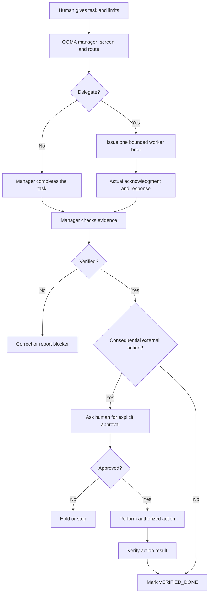

# OGMA

**Use the smallest capable AI team. Keep a human in control. Verify before calling work done.**

OGMA is a **free, model-neutral, copy-and-paste workflow** for coordinating work across two or more AI chats (ChatGPT, Claude, Gemini, or others). It started as operating rules used by Plainwork Labs and is shared here as a public starter kit.

**No programming, API key, automation platform, or paid subscription is required to try the workflow.** You only need access to two AI chats. Free usage limits and each provider's terms still apply.

> **What this is:** A practical playbook, prompts, and handoff templates.
>
> **What this is not:** An API orchestrator, a background-running agent, or an automatically connected team. In the starter version, **you manually copy tasks and results between chats**. Optional connected tools may help, but are not required or assumed.

## Optional LLM Council for important questions

OGMA now includes a **universal council screening rule**: assess every question for whether independent AI review would materially improve the decision, but don't launch multiple models for simple replies. For larger decisions, an optional integration with [The LLM Council](https://github.com/sherifkozman/the-llm-council) provides multi-model drafts, critique and synthesis when **installed and verified** on the actual host. This is an optional enhancement, not part of the manual starter or an automatic ChatGPT cross-provider connection.

Read [the council integration and activation requirements](docs/llm-council.md) and the portable [OGMA council router skill](skills/ogma-council-router/SKILL.md). The existing manager, worker, approval, and verification rules remain authoritative.

## Try it in 5–10 minutes

1. Open **Chat A**, your manager AI. Paste the entire [manager prompt](prompts/manager.md).
2. Open **Chat B**, your worker AI (another model is fine). Paste the [worker prompt](prompts/worker.md).
3. Give the manager the exact fictional task in [the demo](examples/five-minute-demo.md). Ask it to **practice one handoff**.
4. Copy only the manager's **assignment packet** into Chat B. Wait for an actual worker reply. Copy the worker reply back to Chat A.
5. Have Chat A check the result against the original task facts. It should report `VERIFIED_DONE` **only** if the evidence supports completion.

[**Full guided example →**](examples/five-minute-demo.md)

## How it works

**Core rules:**

- **Smallest capable team.** Do simple work directly. Delegate only for a meaningful advantage. Use multiple workers only for independent tasks worth the coordination overhead.
- **Bounded assignments.** Each worker gets a task ID, objective, allowed inputs, exclusions, permission limits, and a required return format.
- **Acknowledgment is not completion.** A shared note or posted assignment does **not** prove another AI was activated. A claim of completion does **not** prove the result.
- **Verify against evidence.** Inspect the actual answer, file, source, or test. Report unknown costs and missing evidence honestly.
- **Human approval stays in place.** No customer contact, purchasing, publishing, deleting, or irreversible changes without separate permission. A draft is not authorization to send.
- **Recover safely.** On timeouts or ambiguous tool failures, check whether the action already happened before retrying.

[Operating rules and task states →](docs/operating-rules.md)

## Included files

| File | Why it's here |
| --- | --- |
| [Manager prompt](prompts/manager.md) | The coordinator's routing, delegation, and verification instructions |
| [Worker prompt](prompts/worker.md) | Universal specialist behavior across models |
| [Reviewer prompt](prompts/reviewer.md) | Optional independent QA when the risk merits another model |
| [Guided demonstration](examples/five-minute-demo.md) | A fully fictional first run, with an example correction |
| [Task template](templates/assignment.md) | Small, exact handoffs to workers |
| [Return template](templates/worker-return.md) | Evidence-bearing worker reports |
| [Sample board](templates/task-board.csv) | Optional single-file task tracking; don't create a second board if you already have one |
| [Operating rules](docs/operating-rules.md) | Task states, recovery, approvals, and verification |
| [Security guidance](SECURITY.md) | Sharing limits and untrusted-input precautions |

## Does it work automatically across AI companies?

**No.** Web chats generally cannot communicate with each other just because you gave them names. Manual copy/paste is the baseline. If your own platform supports tools or connectors, you may adapt the handoffs, but you must independently verify successful delivery, permissions, and results. This project does not imply cross-provider integrations are installed.

## Who is this for?

Solo operators, small businesses, researchers, and developers who already use multiple AI tools and want more disciplined delegation without a complicated infrastructure project.

## Seeking five independent testers

Can you run OGMA with two AI chats? We're collecting **five independent reports** to see what actually works and what needs fixing. The test uses a fictional business, requires no coding or API keys, and involves manual copy/paste between chats.

**[Try OGMA and report your results →](https://github.com/rchisnell01-bit/OGMA-Workflow-/issues/1)**

Failures and confusing steps are welcome. Please don't share private data or claim cross-platform automation you haven't independently verified.

## Help improve it

Try the demo, then open an **Issue** on the GitHub repository where you found this kit. Tell us which AI chats you used, what task you attempted, what actually worked, and what failed. **Do not post private customer data, credentials, or chat logs containing personal information.** See [CONTRIBUTING.md](CONTRIBUTING.md).

**Project status:** v0.1 starter / community testing. The operating ideas come from bounded internal coordination tests, but this public kit has **not yet been independently validated across platforms or users**. Don't interpret example transcripts as benchmark results.

**License:** MIT ([LICENSE](LICENSE)). Not affiliated with or endorsed by any AI model provider.